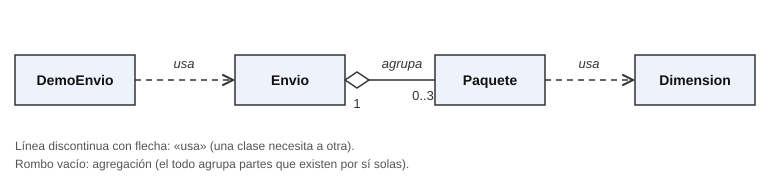

# Proyecto 1 UD4: Envíos y paquetes

## Contexto

PaqExpress es una empresa de paquetería con un centro de distribución en Vigo. Cuando un cliente hace un envío, entrega uno o varios paquetes que van al mismo destino. La empresa cobra según el peso, pero los paquetes muy voluminosos y poco pesados ocupan mucho sitio en las furgonetas. Por eso, además del peso real, se calcula un **peso volumétrico**, y se factura el mayor de los dos.

En este proyecto vas a programar las clases que representan un envío y sus paquetes.

## Objetivos

- Crear objetos que se relacionan entre sí: un envío tiene paquetes y un paquete tiene una dimensión.
- Delegar cada cálculo en el objeto que tiene la información.
- Sobrecargar constructores y métodos.
- Usar constantes de clase (`static final`).
- Diseñar métodos que **devuelven** resultados en lugar de escribirlos en pantalla.

## Normas

1. **Respeta los nombres y las cabeceras de los métodos públicos** que se indican. El profesorado probará tu código con sus propias pruebas. Puedes añadir todos los métodos privados de ayuda que quieras.
2. **`Dimension`, `Paquete` y `Envio` no escriben nada en pantalla.** Solo lo hace `DemoEnvio`.
3. **Cuando el enunciado te deje una decisión de diseño**, explica en un comentario lo que has elegido y por qué.
4. Pon tu nombre detrás de la etiqueta `@author` en las clases que completes.
5. Se valorará que el programa compile y funcione, y que el código esté claro y bien organizado: nombres descriptivos, reglas de estilo de Java, sin código duplicado y con comentarios adecuados.

## Proyecto de partida

Es un proyecto **Maven** para **IntelliJ IDEA**. Las clases están en `src/main/java`, sin paquetes.

### Cómo abrirlo

No hace falta tener activada la opción del explorador de Windows *Abrir carpeta como proyecto*. Basta con hacerlo desde IntelliJ:

1. En la pantalla de bienvenida pulsa **Open**. Si ya tienes un proyecto abierto, usa **File > Open...**
2. Ve a la carpeta del proyecto, selecciona el fichero **`pom.xml`** y pulsa **OK**.
3. Si pregunta, elige **Open as Project** y después **Trust Project**.
4. Espera a que Maven termine de cargar el proyecto (barra de progreso abajo a la derecha). La primera vez necesita conexión a Internet para descargar lo que falte.
5. Si el código aparece en rojo o avisa de que no hay JDK, ve a **File > Project Structure > Project > SDK** y elige un JDK 17 o posterior.

Para ejecutar una clase con método `main`, pulsa la flecha verde que aparece a la izquierda de `main`.

### Clases

Tiene cuatro:

| Clase | Qué hay que hacer |
|---|---|
| `Dimension` | Se da completa, salvo una decisión de diseño. |
| `Paquete` | Completarla. |
| `Envio` | Completarla. |
| `DemoEnvio` | Se da completa. Sirve para probar todo el proyecto. |

### Relaciones entre las clases



- **Agregación** entre `Envio` y `Paquete`: un envío agrupa de 0 a 3 paquetes, pero cada paquete existe por sí mismo (se crea antes y luego se añade al envío).
- `Paquete` usa `Dimension`: la recibe en un constructor y la consulta para calcular su volumen. `Dimension` es una clase independiente que podría usar cualquier otra.
- `DemoEnvio` usa `Envio` y `Paquete` para probarlos. Las otras tres clases no conocen a `DemoEnvio`.
- El rombo está en el lado del **todo**, y las flechas apuntan a la clase conocida: `Envio` conoce a `Paquete`, pero `Paquete` no sabe nada de `Envio`.

## Clase `Dimension`

Representa las medidas exteriores de un paquete, en centímetros: alto, ancho y largo. No tiene métodos para modificarlas: una vez creada, no cambia.

Su `toString()` devuelve, por ejemplo, `40.0 x 30.0 x 50.0 cm`.

> **Decisión de diseño.** `Paquete` tiene que ofrecer un método `calcularVolumen()`. Tienes dos opciones:
> - que `Paquete` pida las tres medidas a su `Dimension` y las multiplique;
> - que `Dimension` tenga su propio método para calcular el volumen y `Paquete` se lo pida.
>
> Elige una y justifícala en un comentario.
>
> *Pistas:*
> - *Pregúntate qué objeto conoce las tres medidas y qué necesitaría saber el otro para hacer el cálculo.*
> - *Si `Paquete` multiplica, ¿cuántos métodos de `Dimension` tiene que llamar? ¿Y si el cálculo lo hace `Dimension`?*
> - *Imagina que mañana otra clase necesita el volumen de una `Dimension`. ¿Con cuál de las dos opciones tendrías que repetir la multiplicación?*

## Clase `Paquete`

Un bulto físico. Tiene una `Dimension` y un peso real (con decimales) en kg. 

- **Constante `FACTOR_VOLUMETRICO = 5000`** (se da). A efectos de facturación, 5000 cm³ «pesan» 1 kg.
- **Constructores:**
  - `Paquete(Dimension dimension, double peso)`.
  - `Paquete(double alto, double ancho, double largo, double peso)`: crea la dimensión con esas medidas. **No repitas** el código del otro constructor.
- **Accesores:** `getDimension()` y `getPeso()`.
- **`calcularVolumen()`:** el volumen en cm³. Ver la decisión de diseño de `Dimension`.

  El **volumen** es el espacio que ocupa el paquete. En una caja con forma de ortoedro se calcula **multiplicando sus tres medidas**:

  `volumen = alto × ancho × largo`

  Como las medidas están en centímetros, el resultado está en **centímetros cúbicos (cm³)**. Por ejemplo, una caja de 40 × 30 × 50 cm tiene un volumen de 40 · 30 · 50 = 60 000 cm³.
- **`calcularPesoVolumetrico()`:** el volumen dividido entre `FACTOR_VOLUMETRICO`.
- **`calcularPesoFacturable()`:** el mayor entre el peso real y el peso volumétrico. Podéis hacerlo con condicionales o con la función ```Math.max()``` (revisa su documentación al escribirla). 
- **`toString()`:** por ejemplo, `40.0 x 30.0 x 50.0 cm | 8.0 kg (facturable 12.0 kg)`. 

Ejemplo: un paquete de 40 × 30 × 50 cm y 8 kg tiene un volumen de 60 000 cm³. Su peso volumétrico es 60 000 / 5000 = 12 kg, así que se factura por 12 kg aunque pese 8.

## Clase `Envio`

Un envío agrupa los paquetes que un cliente manda a un mismo destino. Tiene:

- **Constante de clase `MAX_PAQUETES`:** Nos permite saber el número máximo de paquetes para comparar. Defínela tú (valor 3, `static` y `final`) y úsala en lugar de escribir el número 3.

  > **Decisión de diseño.** Decide su visibilidad: que sea la más restrictiva posible, sin impedir que el programa funcione. Explica en un comentario qué has elegido y por qué.

- un **código de seguimiento**, por ejemplo `PX00000001R`;
- el **código postal** del destino, por ejemplo `36202` (lo aalmacenamos como texto);
- **como máximo tres paquetes**, guardados en tres atributos.

Métodos que debe tener:

- **`Envio(String codigo, String codigoPostal)`:** el envío empieza sin paquetes.
- **Accesores:** `getCodigo()` y `getCodigoPostal()`.
- **`getNumeroPaquetes()`:** cuántos paquetes tiene, de 0 a 3. **No se guarda en ningún atributo:** se calcula cada vez comprobando qué atributos de paquete son `null`. Los paquetes se añaden siempre en orden (primero `paquete1`, después `paquete2` y por último `paquete3`), así que nunca hay huecos entre ellos.

- **`estaCompleto()`:** `true` si ya tiene `MAX_PAQUETES` paquetes.
- **`addPaquete(Paquete paquete)`:** añade el paquete en el primer hueco libre y devuelve `true`. Si el envío está completo, no lo añade y devuelve `false`. **No escribe ningún mensaje:** quien llama al método decide qué hacer.
- **`addPaquete(double alto, double ancho, double largo, double peso)`:** crea el paquete y lo añade. Reutiliza el método anterior.
- **`calcularPesoReal()`:** la suma de los pesos reales de sus paquetes.
- **`calcularPesoFacturable()`:** la suma de los pesos facturables de sus paquetes, **redondeada hacia arriba (con .0 decimal)**.
- **`getPaqueteMasPesado()`:** devuelve el paquete con más peso real. Si hay empate, el que se añadió primero. Si no hay paquetes, `null`.
- **`toString()`:** una cabecera, un paquete por línea y una línea final con los pesos. Evita repetir código ya escrito:

```
Envío PX00000001R -> CP 36202 (2 paquete/s)
  1. 40.0 x 30.0 x 50.0 cm | 8.0 kg (facturable 12.0 kg)
  2. 10.0 x 20.0 x 30.0 cm | 2.5 kg (facturable 2.5 kg)
  Peso real: 10.5 kg | Peso facturable: 15.0 kg
```

## Cómo probarlo

Ejecuta el método `main` de `DemoEnvio`. Debes obtener esta salida:

```
Paquete 1: 40.0 x 30.0 x 50.0 cm | 8.0 kg (facturable 12.0 kg)
  volumen: 60000.0 cm3
Paquete 2: 10.0 x 20.0 x 30.0 cm | 2.5 kg (facturable 2.5 kg)
--------------------------------------------------
Envío PX00000001R -> CP 36202 (2 paquete/s)
  1. 40.0 x 30.0 x 50.0 cm | 8.0 kg (facturable 12.0 kg)
  2. 10.0 x 20.0 x 30.0 cm | 2.5 kg (facturable 2.5 kg)
  Peso real: 10.5 kg | Peso facturable: 15.0 kg
--------------------------------------------------
¿Se añade el tercer paquete? true
¿Se añade un cuarto paquete? false
¿Envío completo? true
--------------------------------------------------
Envío PX00000001R -> CP 36202 (3 paquete/s)
  1. 40.0 x 30.0 x 50.0 cm | 8.0 kg (facturable 12.0 kg)
  2. 10.0 x 20.0 x 30.0 cm | 2.5 kg (facturable 2.5 kg)
  3. 20.0 x 20.0 x 20.0 cm | 9.0 kg (facturable 9.0 kg)
  Peso real: 19.5 kg | Peso facturable: 24.0 kg
Paquete más pesado: 20.0 x 20.0 x 20.0 cm | 9.0 kg (facturable 9.0 kg)
```

`DemoEnvio` no cubre todos los casos. Crea tu propia clase de pruebas con un método `main` (por ejemplo, `MisPruebas`, en `src/main/java`) y comprueba al menos estos: un envío vacío, dos paquetes con el mismo peso y un paquete más pesado que voluminoso.

## Para pensar

No hace falta entregar las respuestas, pero las comentaremos en clase.

1. ¿Quién debería saber calcular el volumen: `Paquete` o `Dimension`? ¿Por qué?
2. `addPaquete` devuelve `true` o `false` en vez de escribir «El envío está completo». ¿Qué ventaja tiene? Piensa en un programa con ventanas en lugar de consola.
3. Si la empresa decidiera admitir 5 paquetes por envío, ¿cuántas líneas de tu código tendrías que cambiar?

## Valoración orientativa

| Apartado | Peso |
|---|---|
| `Paquete` | 25 % |
| `Envio`: constructor, `getNumeroPaquetes`, `estaCompleto`, `addPaquete` (las dos versiones) | 25 % |
| `Envio`: pesos y paquete más pesado | 30 % |
| `toString` de `Paquete` y `Envio` | 10 % |
| Decisiones de diseño justificadas (volumen y visibilidad de `MAX_PAQUETES`) | 10 % |
# PROYECTO_EMPRESA-_DE-_ENVIO
# PROYECTO_EMPRESA-_DE-_ENVIO
